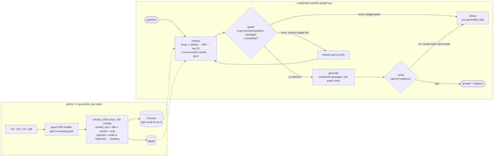
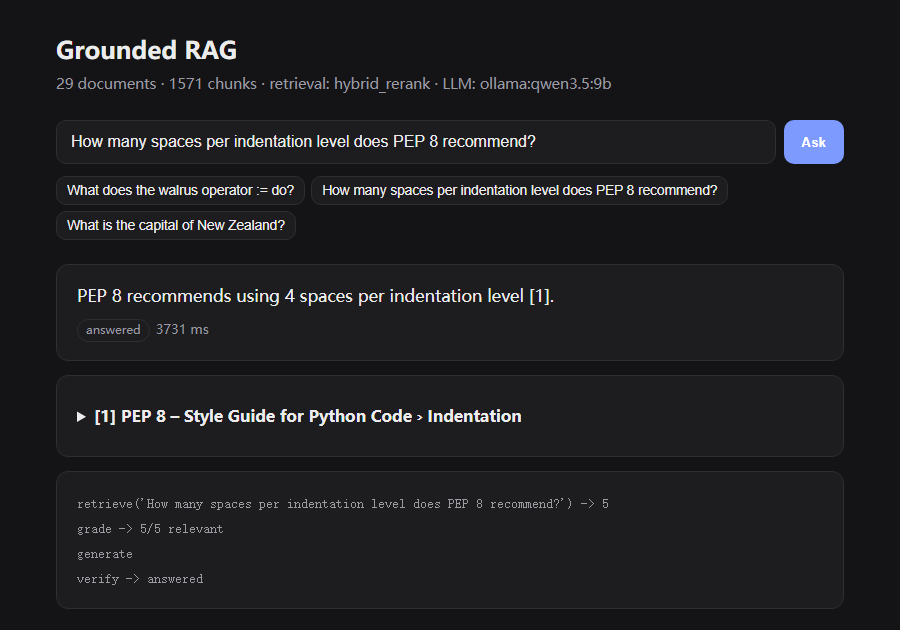
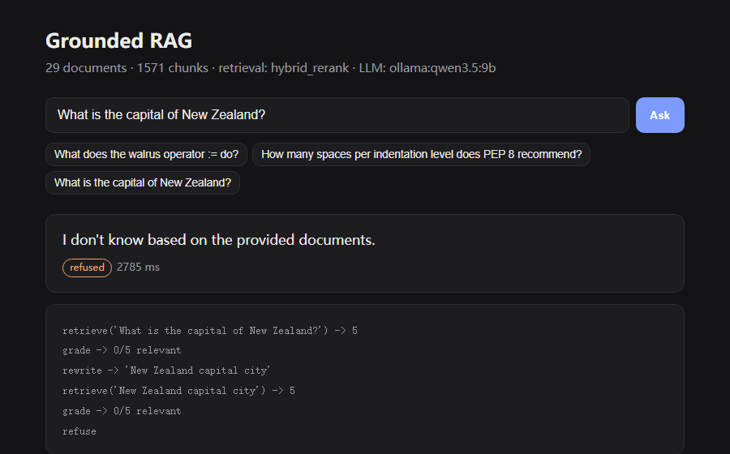

# Grounded RAG

Question answering over a document corpus that **cites its sources or says "I don't know"**.
Hybrid retrieval (dense + BM25, fused with Reciprocal Rank Fusion), a cross-encoder relevance gate,
a LangGraph pipeline with query rewriting and citation verification, a FastAPI service with a web UI,
and an evaluation harness that measures every one of those choices.

## The problem

A plain "retrieve top-k, stuff the prompt" RAG demo answers *every* question, including ones its documents
can't answer, and nothing checks that the answer actually came from the retrieved text. For anything people rely on
(internal docs, specs, policies) a confident, uncited answer is worse than "I don't know". This project treats
**refusing** and **citing** as first-class outputs and puts them outside the model where possible:

- a cross-encoder **relevance gate** decides whether the LLM is called at all;
- a **citation verifier** that fails closed: an answer with no valid `[n]` citation becomes a refusal;
- an **evaluation harness** that measures retrieval per mode, answer accuracy, citation precision, and refusal
  behaviour on unanswerable questions, so each design choice has a number next to it.

The demo corpus is 29 Python Enhancement Proposals (public domain). Point `RAG_CORPUS_DIR` at your own
`.md / .rst / .txt / .pdf` files to use it on anything else.

## Architecture



`answered`, `refused` and `ungrounded` (the model answered but cited nothing valid) are the three statuses every
response carries, along with the retrieved passages and the graph trace.

| Answered, with a citation | Off-topic: rewritten once, then refused |
|---|---|
|  |  |

*The web UI (`python -m grounded_rag serve`) running on a local `qwen3.5:9b`. The bottom card is the pipeline trace. Add `?q=...` to the URL to ask a question directly.*

## Results

45 questions (35 answerable, 10 unanswerable) over 29 documents / 1,571 chunks, run on a laptop
GPU via Ollama. Full per-question reports in [`eval/results/`](eval/results).

> **Provenance.** These numbers were produced at commit `ffed046`. Two later fixes change end-to-end behaviour
> (the relevance gate now re-scores against the original question after a rewrite, and passages from "Rejected …"
> sections are labelled in the prompt; see [`docs/error_analysis.md`](docs/error_analysis.md)). They do **not**
> change retrieval rankings: CI's `retrieval-eval` job rebuilt the real index on the current code and reproduced
> the retrieval table below exactly, misses included. The end-to-end table needs a re-run
> (`python -m grounded_rag eval --e2e`) before it describes the current code. The 29 / 1,571 corpus figures are
> checked by the test suite, and every end-to-end figure recomputes exactly from the per-question rows in the JSON
> files (`tests/test_eval_data.py`).

**Retrieval ablation** (doc-level, top 5; embeddings `bge-small-en-v1.5`, reranker `ms-marco-MiniLM-L-6-v2`)

| Mode | Hit@1 | Hit@5 | MRR@5 |
|---|---|---|---|
| Dense vector only | 0.857 | 0.943 | 0.890 |
| BM25 only | 0.800 | **1.000** | 0.883 |
| Hybrid (RRF) | 0.886 | **1.000** | 0.930 |
| **Hybrid + cross-encoder rerank** (default) | **0.914** | 0.971 | **0.936** |

**End to end** (hybrid + rerank, local models via Ollama)

| | qwen3.5:4b | qwen3.5:9b |
|---|---|---|
| Answer accuracy (35 answerable) | 0.857 | **0.886** |
| Citation precision | **0.974** | 0.965 |
| False-refusal rate | 0.086 | **0.057** |
| Refusal rate on 10 unanswerable | **1.0** | **1.0** |
| Latency p50 / p95 | 3.1 s / 4.3 s | 3.2 s / 5.0 s |

All 10 unanswerable questions were refused, but not all by the gate: some were only refused because the model
itself said "I don't know". The cause was a bug, since fixed: after a query rewrite, the gate reused cross-encoder
scores computed against the *rewritten* query, and the rewrite prompt steers queries toward Python vocabulary
("PostgreSQL replication slot" comes back Python-flavoured), so those passages cleared the gate. The gate now
re-scores against the user's original question; a regression test covers it. The per-question split between
"refused by the gate" and "refused by the model" was not recorded in these runs (the eval now stores the trace).

**What still fails, and why** (details, root causes and evidence in [`docs/error_analysis.md`](docs/error_analysis.md))

- *q33 "How can I assign a value inside an if condition?"* (both models). The top passage is PEP 572's
  **rejected** `if ... as match:` spelling, and the passage itself says "this proposal enhances the syntax", so
  the model presents a rejected idea as the answer. **Fix applied:** chunks under "Rejected …" headings are now
  flagged and labelled in the prompt (116 of 1,571 chunks); effect on the model not yet re-measured.
- *q16 "Which PEP allows `list[int]`?"* (both models). Reranking promoted PEP 604 (whose examples are full of
  `List[...]`) above PEP 585, the only rerank miss in the retrieval table, and the model refused rather than
  guess from the wrong passages. **Proposed fix:** blend the RRF score into the rerank order or keep a doc-diverse
  top 5.
- *q32 "annotate an argument that may be either an int or None"* (both models) is refused: the right PEPs
  are retrieved, but the retrieved passages do not state `Optional[int]` / `int | None` plainly enough for the model.
- *q35* is right in substance but says "a marker file" instead of `EXTERNALLY-MANAGED`, which the strict
  key-term metric counts as wrong.
- *q09* (`pyvenv.cfg`) is refused by the 4b model only; the 9b model answers it.

## Design decisions

**Contextual chunk headers.** Chunks are split on document sections, and each chunk is embedded as
`"<doc title> > <section>\n<text>"`. A passage that says "The default is 79 characters" never names
the style guide; its header does.

**Hybrid retrieval with RRF.** Dense vectors catch paraphrases ("assign a value inside an if condition"
→ assignment expressions); BM25 catches exact identifiers (`pyvenv.cfg`, `__annotations__`) that small
embedding models blur. Reciprocal Rank Fusion combines the two rankings without having to calibrate
their incompatible score scales.

**The relevance gate decides whether the model is called at all.** A cross-encoder scores
(question, passage) pairs; if nothing clears the threshold the graph tries one query rewrite, then
refuses. Clearly off-topic questions are rejected deterministically and cheaply, instead of relying on
the prompt instruction "answer only from context" (see Results for where this guard leaks).

**The verifier fails closed.** The prompt asks for a `[n]` citation on every factual sentence. The verifier
enforces the part that can be checked mechanically: citations pointing at passages that don't exist are stripped,
and an answer left with no valid citation is replaced by a refusal. It does not check that each sentence is cited
or that the cited passage entails the sentence (see Limitations). A wrong refusal costs the user a rephrase; a
confident uncited answer costs trust.

**Rejected ideas are labelled, not removed.** PEPs spend many pages on alternatives they turned down. Those
chunks are still retrievable (they answer "why not X?" questions) but are tagged `REJECTED IDEA` in the prompt,
because the passage text alone often reads like a proposal.

**Provider-agnostic.** The same graph runs on a local model through Ollama (default, free, offline),
Anthropic Claude, or OpenAI, selected by an environment variable. With `RAG_LLM_PROVIDER=none` it
returns the best passages verbatim, which is also how the unit tests run without any model.

## Quick start

```bash
python -m venv .venv && source .venv/bin/activate     # Windows: .venv\Scripts\activate
pip install torch --index-url https://download.pytorch.org/whl/cpu
pip install -e ".[dev]"
cp .env.example .env                                    # choose the LLM provider
ollama pull qwen3.5:4b                                  # default local model

python -m grounded_rag ingest                           # build the index
python -m grounded_rag ask "How can I assign a value inside an if condition?"
python -m grounded_rag search "pyvenv.cfg" --mode bm25  # inspect retrieval only
python -m grounded_rag eval --retrieval-only            # retrieval ablation, no LLM needed
python -m grounded_rag eval --e2e                       # + end-to-end with the configured LLM
python -m grounded_rag serve                            # API + UI at http://127.0.0.1:8000 (?q=... asks directly)
```

`ingest` downloads the embedding and reranker models from Hugging Face on first run (~200 MB).
Reports are written to `eval/results/<tag>.md` and `.json`; the tag is `retrieval` or the LLM name, so a
re-run overwrites the published file of the same name.

Docker (talks to Ollama on the host by default):

```bash
docker compose up --build
```

## API

| Method | Path | |
|---|---|---|
| `POST` | `/ask` `{"question": "..."}` | answer, status (`answered` / `refused` / `ungrounded`), citations, retrieved passages, graph trace, latency |
| `GET` | `/search?q=...&mode=hybrid_rerank&k=5` | retrieval only, any mode |
| `GET` | `/health` | corpus size, retrieval mode, active LLM |
| `GET` | `/` | web UI |

## Evaluation

`eval/questions.jsonl` holds 45 hand-written questions:

- **35 answerable**, each labelled with the PEP(s) that contain the answer and the key terms a correct
  answer must contain. Some deliberately avoid the vocabulary of their source
  (q33 "assign a value inside an if condition", q34, q35) to test semantic retrieval.
- **10 unanswerable**, including near misses that look in-domain ("switch statement in Java",
  "What does PEP 9999 propose?").

Metrics: doc-level Hit@1 / Hit@5 / MRR@5 per retrieval mode; end-to-end answer accuracy, citation
precision, false-refusal rate, refusal rate on unanswerable questions, and p50 / p95 latency.
`tests/test_eval_data.py` checks that every gold key term really occurs in its labelled source document, and
that the published metrics recompute from the per-question rows.

CI runs lint and unit tests (no model downloads), then builds the real index and publishes the
retrieval report to the job summary, runs the browser tests, and builds the Docker image.

## Tests

```bash
pytest            # 98 tests, ~4 s, offline: no API key, no model downloads
ruff check src tests
```

Models are replaced by deterministic fakes (`tests/conftest.py`): hash embeddings, a token-overlap "cross-encoder"
and a scripted chat model that records every prompt it receives. Everything else is real.

| file | covers |
|---|---|
| `test_ingest.py` | PEP header parsing, RST/Markdown heading paths, rejected-section flagging, chunk size/overlap, fragment filtering, stable ids, the 29-doc / 1,571-chunk corpus figure |
| `test_retrieval.py`, `test_retrieval_extra.py` | tokenizer, RRF, BM25 exact-identifier matches, every mode, rerank ordering, gate scoring helper, index save/load |
| `test_grounding.py` | citation verifier edge cases, numbered context, rejected labels, citations map to the passage that was cited |
| `test_refusal.py` | refusal without a generation call, rewrite budget, model "I don't know", regression test for the rewrite/gate leak |
| `test_graph.py`, `test_api.py` | graph paths and the FastAPI endpoints |
| `test_pipeline_e2e.py` | whole pipeline + API + eval harness over the real 29-PEP corpus with the LLM mocked |
| `test_eval_data.py` | question-set shape, gold key terms exist in the source, published metrics match their rows |

## Browser tests (Selenium)

`tests/e2e/` drives the web UI in headless Chrome against a real uvicorn server on a free port. The server uses the
same model-free pipeline as the unit tests (hash embeddings, token-overlap reranker, scripted LLM replies), so
results are deterministic and nothing has to be downloaded. The tests go through a page object
(`tests/e2e/pages.py`) and use explicit waits only, with no `sleep`. A failing test saves a screenshot to
`e2e-artifacts/`, which CI uploads.

They cover what the JSON API tests cannot see:

| test | checks |
|---|---|
| health line | the `/health` fetch fills in corpus size, retrieval mode and LLM |
| answered | the status badge, collapsed citations that expand on click, and the trace |
| refused / ungrounded | off-corpus questions and uncited model answers both show the refusal with no citations |
| HTML escaping | model output containing `` is shown as text and no script runs |
| in-flight state | the Ask button is disabled while a slow model is answering, then re-enabled |
| back-end down | a 503 shows an error badge and the UI recovers |
| `?q=` deep link | the question is filled in and asked on load |
| validation | the browser blocks a question under 3 characters and sends nothing |
| mobile | no horizontal scroll at 375 px width |

```bash
pip install -e ".[dev,e2e]"
pytest -m e2e                 # E2E_HEADED=1 to watch the browser
```

To confirm the suite catches real bugs, I removed `esc()` around the answer in `index.html`; the
HTML-escaping test failed and saved a screenshot.

## Layout

```
src/grounded_rag/
  ingest.py      loading, PEP header parsing, section-aware chunking
  retrieval.py   embeddings, Chroma, BM25, RRF, cross-encoder reranker
  graph.py       LangGraph pipeline, prompts, citation verifier
  llm.py         Ollama / Anthropic / OpenAI behind one interface
  api.py         FastAPI app + web/index.html
  evaluate.py    retrieval ablation and end-to-end metrics
eval/questions.jsonl, eval/results/
docs/            error analysis, interview notes, screenshots
tests/           offline tests with fake embeddings, reranker and LLM
tests/e2e/       Selenium browser tests (page object, live uvicorn server)
```

## Limitations

- Answer correctness is scored by key-term matching, which is strict about wording (q35) and blind to extra
  wrong claims.
- The verifier checks that citations exist, not that the cited passage supports the sentence, and does not
  require every sentence to be cited.
- 45 questions written by one person over one corpus: enough to compare configurations, not to claim
  general accuracy. At n = 35 one question is ~2.9 points of accuracy, so the 4b vs 9b gap (one question) is noise.
- The relevance threshold (-2.0) was tuned on the same questions it is evaluated on.
- Single-turn only; no conversation memory. The index is rebuilt from scratch on every `ingest`.
- The end-to-end numbers predate the two fixes described above.

## Next steps

1. Re-run `eval --e2e` on both models to measure the gate fix and the rejected-idea labels.
2. LLM-as-judge (or NLI) faithfulness: does each cited passage entail its sentence?
3. Blend RRF and cross-encoder scores, or keep a doc-diverse top 5, for q16-style rerank misses.
4. Hold out a tuning split for the relevance threshold; grow the question set and add a second corpus.
5. Incremental ingest (hash per document) instead of full rebuilds.

More: [`docs/error_analysis.md`](docs/error_analysis.md) (four failure cases with evidence) and
[`docs/interview_notes.md`](docs/interview_notes.md) (design trade-offs, Q&A).

## License

Code: MIT. Corpus: the PEPs in `data/corpus` are placed in the public domain by their authors.
